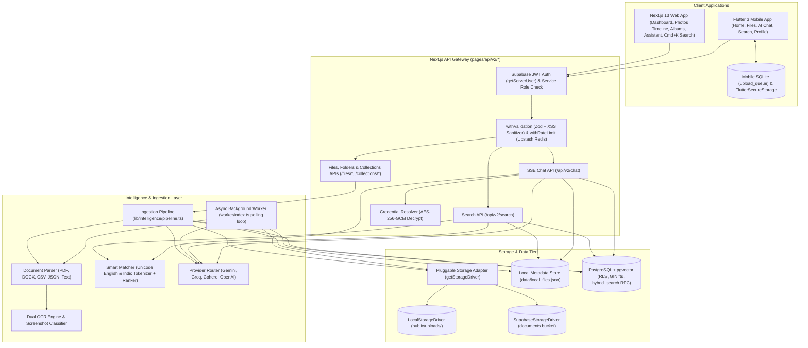
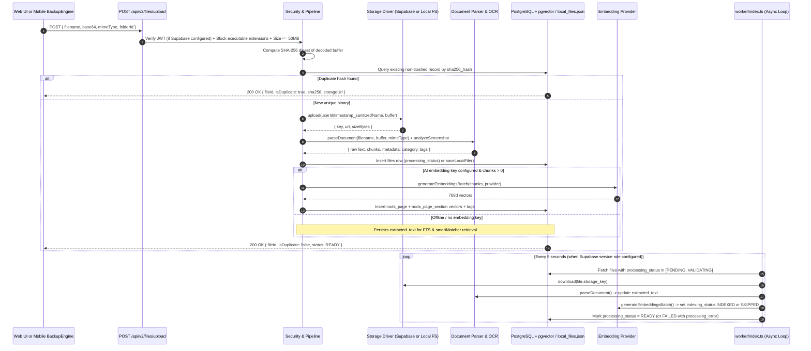
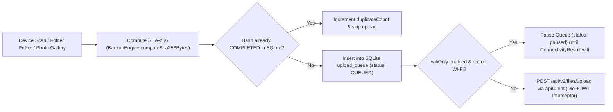
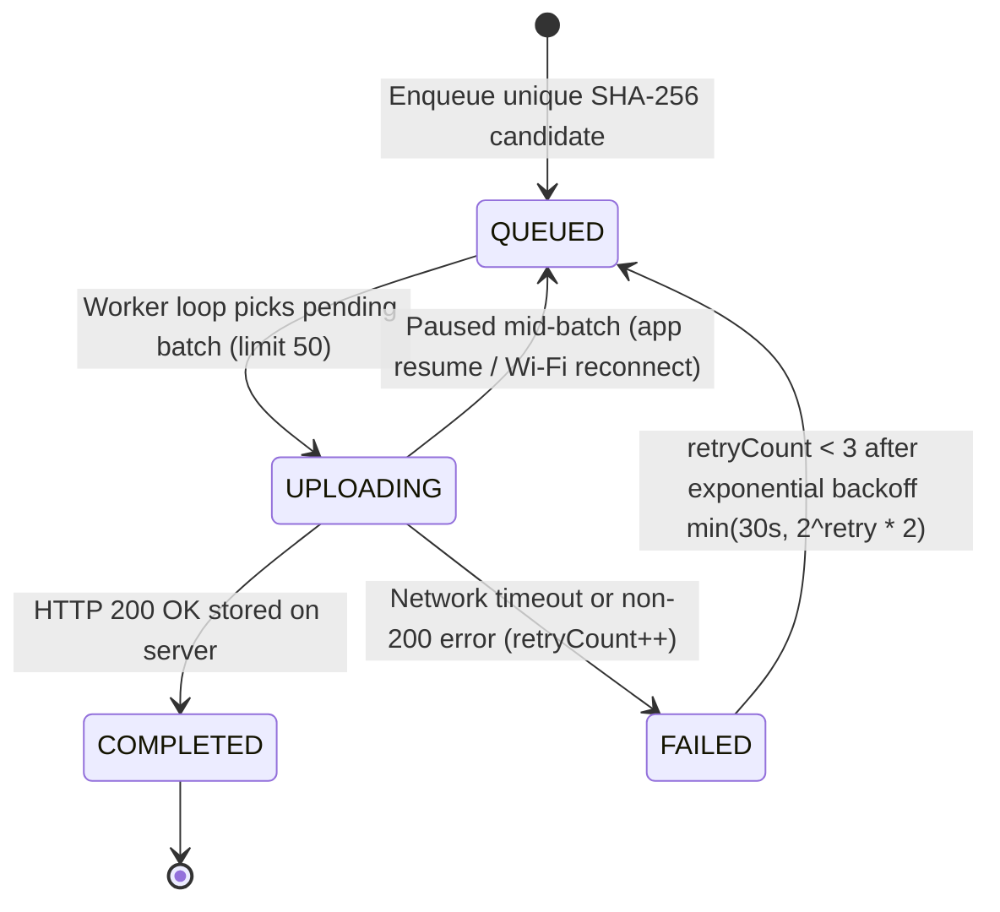
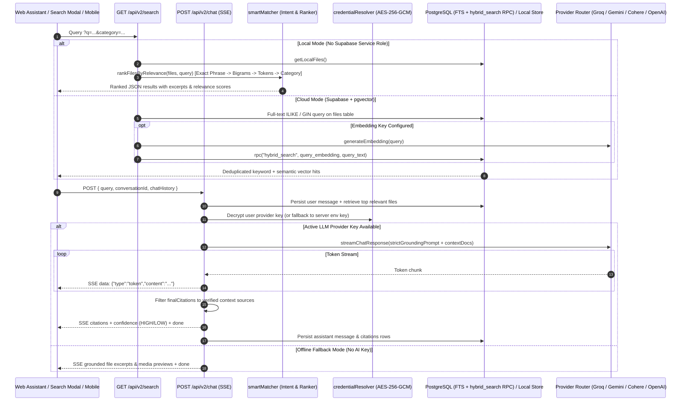
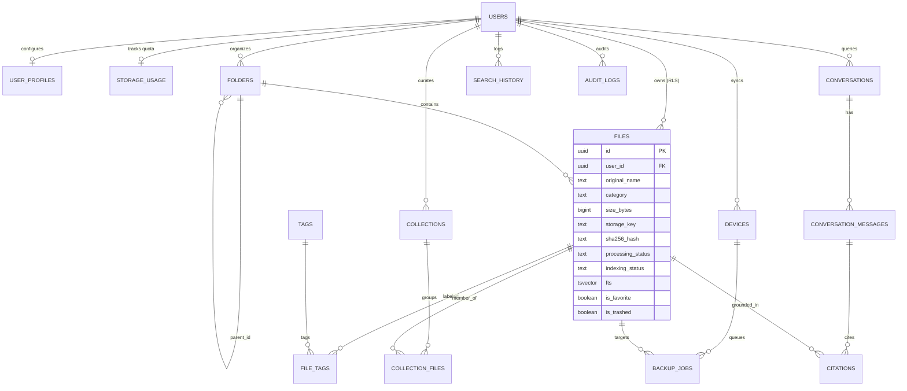

# ⚡ VectorGallery
### Personal AI Cloud & Intelligent Digital Memory Platform

<div align="center">
  
  <br /><br />

  [](https://nextjs.org/)
  [](https://flutter.dev/)
  [](https://supabase.com/)
  [](https://www.typescriptlang.org/)
  [](.github/workflows/ci.yml)
  [](LICENSE)

  <p>
    A unified personal storage platform where you can automatically back up, organize, search, retrieve, understand, and interact with all your digital files and memories.
  </p>

  <p>
    <a href="#-architecture--data-flows">Architecture</a> •
    <a href="#1-end-to-end-system-topology">System Topology</a> •
    <a href="#2-ingestion-deduplication--worker-pipeline">Ingestion Pipeline</a> •
    <a href="#3-mobile-offline-backup--sync-state-machine">Mobile Sync</a> •
    <a href="#4-hybrid-search--grounded-sse-chat-flow">Search & AI Flow</a> •
    <a href="#5-database-schema--rls-data-model">Data Model</a> •
    <a href="#-quickstart--local-development">Quickstart</a>
  </p>
</div>

---

## 📖 What is VectorGallery?

VectorGallery replaces fragmented cloud storage, lost screenshot folders, and scattered notes with a **single, unified, AI-powered personal cloud**:

> **"You don't need to remember where you saved something. You simply ask VectorGallery."**

### Real-World Use Cases:
- *"Find the screenshot where I saved AWS EC2 pricing."* → Returns the image preview with highlighted OCR pricing tables.
- *"Find my college admission PDF."* → Returns the original letter with cited page numbers.
- *"Find all bills and receipts saved last month."* → Dynamically displays detected receipts.
- *"Summarize my notes about Docker containers."* → Generates a synthesis strictly grounded in your files.

Every answer is **grounded in retrieved content** with real clickable citations. VectorGallery **never hallucinates or fabricates citations**.

---

## 🧠 Architecture & Data Flows

VectorGallery is built around a **dual-mode architecture** (full cloud PostgreSQL + pgvector with Supabase RLS, or zero-config local filesystem + JSON metadata fallback) shared across both the Next.js web app and the Flutter mobile client.

### 1. End-to-End System Topology



---

### 2. Ingestion, Deduplication & Worker Pipeline

Every binary upload passes through extension blocklists, payload bounds (`50MB`), SHA-256 deduplication, storage abstraction, multimodal extraction, and optional vector indexing or async worker processing:



---

### 3. Mobile Offline Backup & Sync State Machine

`mobile/lib/features/backup/backup_engine.dart` coordinates non-destructive device scanning, SHA-256 deduplication against local SQLite (`mobile/lib/core/storage/local_database.dart`), Wi-Fi connectivity gating, and exponential backoff retries:





---

### 4. Hybrid Search & Grounded SSE Chat Flow

VectorGallery guarantees retrieval works both **with cloud AI keys** (pgvector RRF + SSE token streaming) and **completely offline** (multilingual keyword + Unicode Indic `\p{L}\p{M}` token ranking + deterministic cited summaries):



---

### 5. Database Schema & RLS Data Model

All tenant tables in [supabase/migrations/20261117_vectormind_v2_core.sql](supabase/migrations/20261117_vectormind_v2_core.sql) and [supabase/migrations/20261117_vectormind_v2_extensions.sql](supabase/migrations/20261117_vectormind_v2_extensions.sql) enforce PostgreSQL Row-Level Security (`auth.uid() = user_id`):



---

## ✨ Key Capabilities

### 1. Unified File Storage & Management
- Supports **PDF, DOCX, DOC, XLSX, XLS, CSV, TXT, MD, JSON, PNG, JPG, JPEG, WEBP, GIF, HEIC, MP4, MOV, MP3, WAV, M4A**.
- Actions: Upload, Download, Preview, Rename, Move, Favorite, Soft-delete (Trash), Restore, Permanent purge.
- Fast cursor-based pagination and category filters.

### 2. Apple iCloud / Linear Design System
- Minimal, calm, and elegant interface with subtle glassmorphism surfaces.
- **Desktop Navigation:** 12-item sidebar (Home, AI Search, Assistant, Photos, Videos, Documents, Audio, Downloads, Collections, Recent, Favorites, Trash) + real-time storage bar, device status, and settings.
- **Mobile Navigation:** Bottom navigation (Home, Search, Memories, Files, Profile).

### 3. Real Storage Dashboard
- **No hardcoded stats:** Live byte calculations for used storage, quota, file count, photo count, screenshot count, document count, and video count.
- Device backup health indicator with sync timestamps.

### 4. Automatic Mobile Backup Engine (Flutter)
- Located in `mobile/`.
- Incremental camera roll, screenshot, and document scanning.
- **SHA-256 duplicate detection:** Identical files are recognized immediately and never re-uploaded.
- **Offline queue persistence:** Handled via SQLite (`sqflite`).
- **Resilient retry:** Exponential backoff ($T = \min(60, 2^{\text{retry}} \times 2)$).
- **Wi-Fi only mode:** Saves cellular mobile data.
- **Never deletes local phone files:** Backup is strictly non-destructive.

### 5. Multi-Format Intelligence & Offline OCR
- **Dual-Engine OCR:** Local zero-cost heuristic extraction + Google Gemini 2.0 Flash Vision multimodal fallback.
- **Screenshot Analyzer:** Automatically classifies error screens, code snippets, receipts, and AWS/tech consoles.
- **Spreadsheet Parser:** Extracts sheet names, column headers, and structured cell rows for CSV/XLSX.

### 6. Grounded AI Assistant & Citations
- Streaming Server-Sent Events (SSE) chat.
- Every claim referencing personal files includes a source link with file name, page number, and excerpt.
- If content does not exist, VectorGallery clearly states so.

---

## 🚀 Quickstart & Local Development

### Prerequisites
- Node.js 18+ (tested on Node v26)
- npm 9+
- Optional: Flutter 3.x (for mobile application)
- Optional: Supabase project (or runs locally out-of-the-box with `LocalStorageDriver`)

### 1. Clone & Install
```bash
git clone https://github.com/krishsoni15/VectorGallery.git
cd VectorGallery

# Install web dependencies
npm install
```

### 2. Configure Environment
Copy the example environment file:
```bash
cp .env.example .env.local
```

Edit `.env.local`:
```bash
# Supabase Configuration (Optional for full cloud DB, runs with local mock if empty)
NEXT_PUBLIC_SUPABASE_URL=https://your-project.supabase.co
NEXT_PUBLIC_SUPABASE_ANON_KEY=your_anon_key
SUPABASE_SERVICE_ROLE_KEY=your_service_role_key

# Encryption Key for Stored API Credentials (32-byte hex)
CREDENTIAL_ENCRYPTION_KEY=your_32_byte_hex_key

# Storage Driver: 'local' | 'supabase' | 'r2'
STORAGE_PROVIDER=local

# Optional AI Providers (Basic keyword search and file management work without keys)
GEMINI_API_KEY=your_gemini_key
GROQ_API_KEY=your_groq_key
COHERE_API_KEY=your_cohere_key
OPENAI_API_KEY=your_openai_key
```

### 3. Run Web Application & Worker
```bash
# Terminal 1: Run Web Application
npm run dev

# Terminal 2: Run Background Intelligence Worker
npm run worker
```
Open [http://localhost:3000](http://localhost:3000) in your browser.

### 4. Run Mobile Application
```bash
cd mobile
flutter pub get
flutter run
```

---

## 📁 Repository Structure

```text
VectorGallery/
├── components/              # Modular React views (assistant, collections, dashboard, files, layout, search, settings)
├── lib/
│   ├── intelligence/        # Multi-format parser, dual-engine OCR & screenshot analyzer
│   ├── search/              # Multilingual intent parser & relevance ranker
│   ├── storage/             # Pluggable storage drivers (Local FS, Supabase, R2/S3)
│   ├── encryption.ts        # AES-256-GCM key vault encryption
│   ├── rateLimiter.ts       # Sliding-window Redis / fail-open rate limiting
│   └── validateRequest.ts   # Zod schemas & XSS/null-byte sanitization
├── pages/
│   ├── api/v2/              # Versioned REST & SSE streaming API endpoints
│   ├── app/                 # Authenticated & local workspace application shell
│   └── install.tsx          # Android APK distribution & setup page
├── mobile/                  # Flutter 3 cross-platform mobile client + backup engine
├── worker/                  # Background file ingestion & embedding worker
├── supabase/migrations/     # Incremental PostgreSQL + pgvector migrations
├── tests/                   # Vitest unit, intelligence, integration & lifecycle suites
└── docs/                    # Architecture, API, database, security & deployment specs
```

---

## 🧪 Testing & Verification

VectorGallery includes automated tests across the backend/intelligence tier, API security routes, and Flutter mobile client:

```bash
# Run web typecheck, lint & Vitest suite
npm run check

# Or execute individually
npm run typecheck
npm run lint
npm test
npm run build

# Run mobile static analysis & unit/widget tests
cd mobile && flutter analyze && flutter test
```

---

## 🔒 Security & Privacy

1. **Server-Side Authentication:** Requests verify Supabase JWT tokens (`auth.getUser(token)`) with Row Level Security enforced at the database layer.
2. **Input Sanitization & Guardrails:** Upload routes block executable extensions, enforce 50MB payload limits, validate payloads via Zod schemas, and strip HTML/script tags from queries.
3. **Application-Level Encryption:** Provider API credentials are encrypted at rest with **AES-256-GCM** using per-record random IVs.
4. **Tenant Isolation:** Personal files, embeddings, and chat history remain strictly scoped to the owning user.

---

## 📚 Engineering Documentation

Technical specifications are organized in [`docs/`](docs/):
- [`docs/API_DESIGN.md`](docs/API_DESIGN.md) & [`docs/API_REFERENCE.md`](docs/API_REFERENCE.md) — REST & SSE API contracts.
- [`docs/DATABASE_DESIGN.md`](docs/DATABASE_DESIGN.md) & [`docs/DATABASE_SETUP.md`](docs/DATABASE_SETUP.md) — ER diagrams and PostgreSQL + pgvector schemas.
- [`docs/ENVIRONMENT_SETUP.md`](docs/ENVIRONMENT_SETUP.md) & [`docs/LOCAL_SERVER_SETUP.md`](docs/LOCAL_SERVER_SETUP.md) — Environment configuration and local development.
- [`docs/PRODUCTION_DEPLOYMENT.md`](docs/PRODUCTION_DEPLOYMENT.md) — Production topology and deployment targets.
- [`docs/SECURITY.md`](docs/SECURITY.md) — Threat model, encryption specifications, and RLS policies.
- [`docs/TESTING_PLAN.md`](docs/TESTING_PLAN.md) — Automated verification strategy across web and mobile.
- [`mobile/README.md`](mobile/README.md) — Flutter client architecture and Android APK build guide.

See [`CONTRIBUTING.md`](CONTRIBUTING.md) for contributor guidelines and pull request checks.

---

## 📄 License
Apache License 2.0 — see [`LICENSE`](LICENSE).
