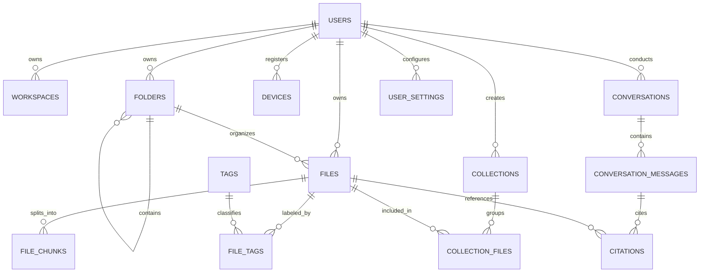

# VectorGallery — Database Design & Schema Specification

## 1. Overview & Strategy

The VectorGallery database architecture extends PostgreSQL with `pgvector` and standard full-text search (`tsvector`). It ensures complete backward compatibility with existing VectorGallery 1.x installations (`nods_project`, `nods_page`, `nods_page_section`, `user_provider_keys`) while introducing relational schemas for production cloud storage, intelligent digital memories, and mobile backup tracking.

All tables are strictly protected by PostgreSQL Row Level Security (RLS) bound to authenticated users (`auth.uid() = user_id`).

---

## 2. Entity-Relationship Model



---

## 3. Detailed Entity Schemas

### 3.1 Existing Tables (Preserved & Extended)

- **`nods_project` / `workspaces`:**
  - `id` (uuid, PK, default `gen_random_uuid()`)
  - `name` (text, not null)
  - `user_id` (uuid, FK `auth.users(id) ON DELETE CASCADE`)
  - `provider` (text, default `'cohere'`)
  - `embedding_provider` (text, default `'gemini'`)
  - `chat_provider` (text, default `'gemini'`)
  - `created_at` (timestamptz, default `now()`)

- **`nods_page`:**
  - `id` (bigserial, PK)
  - `project_id` (text, not null)
  - `user_id` (uuid, FK `auth.users(id) ON DELETE CASCADE`)
  - `path` (text, not null)
  - `checksum` (text, SHA-256)
  - `meta` (jsonb)
  - `type` (text)

- **`nods_page_section`:**
  - `id` (bigserial, PK)
  - `page_id` (bigint, FK `nods_page(id) ON DELETE CASCADE`)
  - `content` (text)
  - `token_count` (int)
  - `embedding` (vector(768))
  - `chunk_level` (int)
  - `heading_context` (text)
  - `page_number` (int)
  - `fts` (tsvector, generated via trigger)

- **`user_provider_keys`:**
  - `id` (uuid, PK)
  - `user_id` (uuid, FK `auth.users(id) ON DELETE CASCADE`)
  - `provider` (text, check `provider IN ('gemini', 'openai', 'groq', 'cohere', 'ollama')`)
  - `encrypted_api_key` (text, AES-256-GCM)
  - `key_last4` (text)
  - `created_at` (timestamptz)
  - `updated_at` (timestamptz)

---

### 3.2 VectorGallery Core Entities

#### `folders`
Organizes files in user-defined hierarchical folder trees.
```sql
CREATE TABLE IF NOT EXISTS public.folders (
    id uuid PRIMARY KEY DEFAULT gen_random_uuid(),
    user_id uuid NOT NULL REFERENCES auth.users(id) ON DELETE CASCADE,
    parent_id uuid REFERENCES public.folders(id) ON DELETE CASCADE,
    name text NOT NULL,
    color text DEFAULT '#1D9E75',
    icon text DEFAULT 'folder',
    is_favorite boolean DEFAULT false,
    created_at timestamptz NOT NULL DEFAULT now(),
    updated_at timestamptz NOT NULL DEFAULT now()
);
```

#### `files`
Unified metadata registry for all user files across web and mobile.
```sql
CREATE TABLE IF NOT EXISTS public.files (
    id uuid PRIMARY KEY DEFAULT gen_random_uuid(),
    user_id uuid NOT NULL REFERENCES auth.users(id) ON DELETE CASCADE,
    folder_id uuid REFERENCES public.folders(id) ON DELETE SET NULL,
    original_name text NOT NULL,
    sanitized_name text NOT NULL,
    mime_type text NOT NULL,
    category text NOT NULL CHECK (category IN ('photos', 'videos', 'documents', 'audio', 'screenshots', 'other')),
    size_bytes bigint NOT NULL DEFAULT 0,
    storage_key text NOT NULL,
    storage_provider text NOT NULL DEFAULT 'supabase', -- 'supabase' | 'r2' | 's3' | 'local'
    sha256_hash text NOT NULL,
    thumbnail_url text,
    extracted_text text,
    processing_status text NOT NULL DEFAULT 'PENDING' CHECK (processing_status IN ('PENDING', 'VALIDATING', 'EXTRACTING', 'GENERATING_METADATA', 'GENERATING_EMBEDDINGS', 'INDEXING', 'READY', 'FAILED')),
    indexing_status text NOT NULL DEFAULT 'PENDING' CHECK (indexing_status IN ('PENDING', 'INDEXED', 'SKIPPED', 'FAILED')),
    processing_error text,
    metadata jsonb DEFAULT '{}'::jsonb, -- EXIF, duration, dimensions, OCR tags, etc.
    is_favorite boolean NOT NULL DEFAULT false,
    is_trashed boolean NOT NULL DEFAULT false,
    trashed_at timestamptz,
    created_at timestamptz NOT NULL DEFAULT now(),
    updated_at timestamptz NOT NULL DEFAULT now()
);
```

#### `devices`
Tracks connected desktop and mobile clients performing backups.
```sql
CREATE TABLE IF NOT EXISTS public.devices (
    id uuid PRIMARY KEY DEFAULT gen_random_uuid(),
    user_id uuid NOT NULL REFERENCES auth.users(id) ON DELETE CASCADE,
    device_name text NOT NULL,
    platform text NOT NULL CHECK (platform IN ('android', 'ios', 'web', 'macos', 'windows', 'linux')),
    device_identifier text NOT NULL,
    app_version text,
    last_sync_at timestamptz,
    sync_status text DEFAULT 'IDLE' CHECK (sync_status IN ('IDLE', 'SYNCING', 'PAUSED', 'ERROR')),
    settings jsonb DEFAULT '{"wifi_only": true, "auto_backup": true, "categories": ["photos", "documents", "screenshots"]}'::jsonb,
    created_at timestamptz NOT NULL DEFAULT now(),
    updated_at timestamptz NOT NULL DEFAULT now(),
    UNIQUE(user_id, device_identifier)
);
```

#### `backup_jobs`
Tracks stateful backup sessions and individual upload queue items.
```sql
CREATE TABLE IF NOT EXISTS public.backup_jobs (
    id uuid PRIMARY KEY DEFAULT gen_random_uuid(),
    user_id uuid NOT NULL REFERENCES auth.users(id) ON DELETE CASCADE,
    device_id uuid REFERENCES public.devices(id) ON DELETE CASCADE,
    file_id uuid REFERENCES public.files(id) ON DELETE SET NULL,
    local_path text NOT NULL,
    sha256_hash text NOT NULL,
    file_size bigint NOT NULL,
    status text NOT NULL DEFAULT 'QUEUED' CHECK (status IN ('QUEUED', 'UPLOADING', 'COMPLETED', 'FAILED', 'PAUSED')),
    progress_percentage float NOT NULL DEFAULT 0.0,
    retry_count int NOT NULL DEFAULT 0,
    error_message text,
    started_at timestamptz,
    completed_at timestamptz,
    created_at timestamptz NOT NULL DEFAULT now()
);
```

#### `collections` & `collection_files`
Smart collections and user-curated memory albums.
```sql
CREATE TABLE IF NOT EXISTS public.collections (
    id uuid PRIMARY KEY DEFAULT gen_random_uuid(),
    user_id uuid NOT NULL REFERENCES auth.users(id) ON DELETE CASCADE,
    name text NOT NULL,
    description text,
    type text NOT NULL DEFAULT 'custom' CHECK (type IN ('custom', 'screenshots', 'important', 'work', 'college', 'bills', 'travel', 'duplicates')),
    filter_criteria jsonb DEFAULT '{}'::jsonb,
    is_smart boolean NOT NULL DEFAULT false,
    icon text,
    cover_image_url text,
    created_at timestamptz NOT NULL DEFAULT now(),
    updated_at timestamptz NOT NULL DEFAULT now()
);

CREATE TABLE IF NOT EXISTS public.collection_files (
    collection_id uuid NOT NULL REFERENCES public.collections(id) ON DELETE CASCADE,
    file_id uuid NOT NULL REFERENCES public.files(id) ON DELETE CASCADE,
    added_at timestamptz NOT NULL DEFAULT now(),
    PRIMARY KEY (collection_id, file_id)
);
```

#### `tags` & `file_tags`
Labels generated automatically via OCR/AI or assigned by the user.
```sql
CREATE TABLE IF NOT EXISTS public.tags (
    id uuid PRIMARY KEY DEFAULT gen_random_uuid(),
    user_id uuid NOT NULL REFERENCES auth.users(id) ON DELETE CASCADE,
    name text NOT NULL,
    source text NOT NULL DEFAULT 'user' CHECK (source IN ('user', 'ocr', 'ai')),
    created_at timestamptz NOT NULL DEFAULT now(),
    UNIQUE(user_id, name)
);

CREATE TABLE IF NOT EXISTS public.file_tags (
    file_id uuid NOT NULL REFERENCES public.files(id) ON DELETE CASCADE,
    tag_id uuid NOT NULL REFERENCES public.tags(id) ON DELETE CASCADE,
    PRIMARY KEY (file_id, tag_id)
);
```

#### `conversations`, `conversation_messages`, & `citations`
Persistent multi-turn chat history with citations grounded in personal files.
```sql
CREATE TABLE IF NOT EXISTS public.conversations (
    id uuid PRIMARY KEY DEFAULT gen_random_uuid(),
    user_id uuid NOT NULL REFERENCES auth.users(id) ON DELETE CASCADE,
    title text NOT NULL DEFAULT 'New Conversation',
    provider text DEFAULT 'gemini',
    created_at timestamptz NOT NULL DEFAULT now(),
    updated_at timestamptz NOT NULL DEFAULT now()
);

CREATE TABLE IF NOT EXISTS public.conversation_messages (
    id uuid PRIMARY KEY DEFAULT gen_random_uuid(),
    conversation_id uuid NOT NULL REFERENCES public.conversations(id) ON DELETE CASCADE,
    role text NOT NULL CHECK (role IN ('user', 'assistant', 'system')),
    content text NOT NULL,
    confidence_level text CHECK (confidence_level IN ('HIGH', 'MEDIUM', 'LOW')),
    grounding_score float,
    created_at timestamptz NOT NULL DEFAULT now()
);

CREATE TABLE IF NOT EXISTS public.citations (
    id uuid PRIMARY KEY DEFAULT gen_random_uuid(),
    message_id uuid NOT NULL REFERENCES public.conversation_messages(id) ON DELETE CASCADE,
    file_id uuid REFERENCES public.files(id) ON DELETE SET NULL,
    file_name text NOT NULL,
    page_number int,
    excerpt text NOT NULL,
    similarity float,
    created_at timestamptz NOT NULL DEFAULT now()
);
```

#### `storage_usage` & `audit_logs`
Real metrics and security tracking per account.
```sql
CREATE TABLE IF NOT EXISTS public.storage_usage (
    user_id uuid PRIMARY KEY REFERENCES auth.users(id) ON DELETE CASCADE,
    total_bytes_used bigint NOT NULL DEFAULT 0,
    total_bytes_quota bigint NOT NULL DEFAULT 16106127360, -- 15 GB default
    file_count int NOT NULL DEFAULT 0,
    photos_count int NOT NULL DEFAULT 0,
    videos_count int NOT NULL DEFAULT 0,
    documents_count int NOT NULL DEFAULT 0,
    audio_count int NOT NULL DEFAULT 0,
    screenshots_count int NOT NULL DEFAULT 0,
    updated_at timestamptz NOT NULL DEFAULT now()
);

CREATE TABLE IF NOT EXISTS public.audit_logs (
    id uuid PRIMARY KEY DEFAULT gen_random_uuid(),
    user_id uuid REFERENCES auth.users(id) ON DELETE SET NULL,
    action text NOT NULL,
    resource_type text NOT NULL,
    resource_id text,
    ip_address text,
    user_agent text,
    details jsonb DEFAULT '{}'::jsonb,
    created_at timestamptz NOT NULL DEFAULT now()
);
```

---

## 4. Indexing & Optimization

1. **Foreign Keys & Filtering:**
   - `idx_files_user_id` on `files(user_id)`
   - `idx_files_category` on `files(user_id, category)`
   - `idx_files_is_trashed` on `files(user_id, is_trashed)`
   - `idx_files_is_favorite` on `files(user_id, is_favorite)`
   - `idx_files_sha256` on `files(user_id, sha256_hash)` for instant duplicate matching
   - `idx_files_folder_id` on `files(folder_id)`
2. **Full-Text Search:**
   - GIN index on `files` searchable metadata and extracted text:
     ```sql
     ALTER TABLE public.files ADD COLUMN IF NOT EXISTS fts tsvector;
     CREATE INDEX IF NOT EXISTS idx_files_fts ON public.files USING gin(fts);
     ```
3. **Vector Embeddings:**
   - Preserves existing HNSW index `nods_page_section_embedding_idx` on 768-dimensional embeddings using `vector_cosine_ops`.

